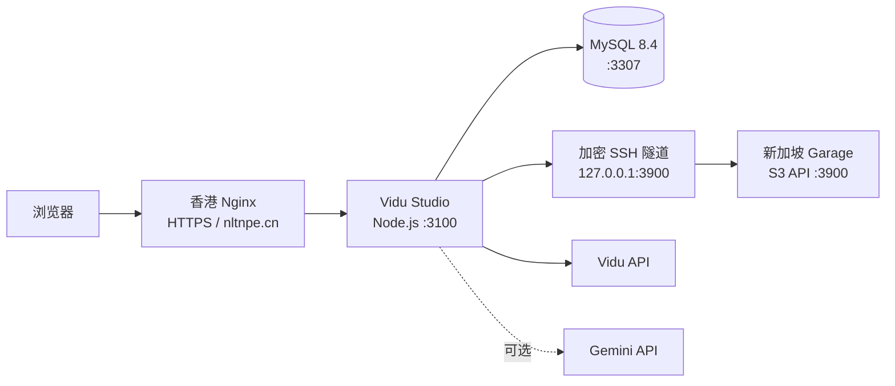

# Vidu Studio Self-host

一个可自托管的多用户 AI 视频生产工作台。前端与 API 运行在 Node.js，MySQL 保存用户、会话、额度、任务和审计数据，Garage 提供 S3 兼容的图片与视频对象存储。视频生成接入 Vidu，视频预分析可选接入 Gemini。

生产实例：<https://nltnpe.cn>

## 当前能力

- Vidu Q2 Pro 参考图/参考视频生成。
- 人物替换与 Motion Sync 动作迁移。
- 可选 Gemini Files + Interactions 视频预分析。
- 访问口令注册、邮箱密码登录和安全会话。
- 多用户额度账本、每日额度、并发限制与任务结算。
- 管理员用户、访问口令、额度、审计和 Provider Key 管理。
- 分块上传图片/视频到 Garage，单文件上限 50 MB。
- 中文/英文、深色/浅色主题及响应式界面。

## 部署架构



应用、MySQL 与 Nginx 位于香港服务器；Garage 位于新加坡服务器。Garage 的 S3 端口只绑定回环地址，香港服务器通过长期运行的 SSH 隧道访问，不向公网直接暴露对象存储端口。

## 技术栈

| 层 | 技术 |
| --- | --- |
| Web | React 19、Next.js 16 App Router、Vinext、Tailwind CSS 4 |
| 运行时 | Node.js 22、Docker Compose、Nginx |
| 数据 | MySQL 8.4、Drizzle ORM、MySQL D1 兼容适配层 |
| 对象存储 | Garage 2.3、AWS S3 SDK |
| 上游服务 | Vidu API、可选 Gemini API |
| 验证 | Node test runner、tsx、ESLint、生产构建、深度健康检查 |

## 快速开始

要求：Docker Engine、Docker Compose v2，以及可访问的 S3 兼容对象存储。

```bash
git clone https://github.com/Alex-python-l/vidu-studio-selfhost.git
cd vidu-studio-selfhost
cp .env.production.example .env
docker volume create vidu-studio-mysql-data
docker compose --env-file .env up -d --build
```

启动前必须替换 `.env` 中的示例密码、S3 凭证和所有安全密钥。`.env` 已被 Git 忽略，不得提交。

默认服务地址：

- 应用：`http://127.0.0.1:3100`
- MySQL：`127.0.0.1:3307`
- Garage/S3：`http://127.0.0.1:3900`

验证：

```bash
./deploy/check-mysql.sh
./deploy/check-app.sh
```

`check-app.sh` 的深度检查会真实执行一次 MySQL 查询，并在 Garage 中写入、读取和删除一个临时对象。

完整服务器部署、Nginx 配置、升级与回滚流程见 [docs/DEPLOY.md](docs/DEPLOY.md)。

## 本地开发

本地开发仍需要可用的 MySQL 与 S3 兼容端点：

```powershell
Copy-Item .env.production.example .env
docker volume create vidu-studio-mysql-data
docker compose --env-file .env up -d mysql
npm ci
npm run dev
```

生产构建和完整回归：

```powershell
npm run build
npm test
```

项目要求 Node.js `>=22.13.0`。

## 关键环境变量

| 变量 | 要求 | 用途 |
| --- | --- | --- |
| `MYSQL_PASSWORD` | 必需 | 应用数据库用户密码 |
| `MYSQL_ROOT_PASSWORD` | 必需 | MySQL 初始化与维护密码 |
| `GARAGE_DEFAULT_BUCKET` | 必需 | 媒体 Bucket |
| `GARAGE_DEFAULT_ACCESS_KEY` | 必需 | S3 Access Key |
| `GARAGE_DEFAULT_SECRET_KEY` | 必需 | S3 Secret Key |
| `SESSION_TOKEN_PEPPER` | 必需 | 会话 Token 的 HMAC Pepper |
| `ABUSE_HASH_SECRET` | 必需 | 登录、上传和任务限流摘要密钥 |
| `PROVIDER_KEY_ENCRYPTION_SECRET` | 必需 | 后台托管 Provider Key 的 AES-GCM 根密钥 |
| `INTERNAL_HEALTH_SECRET` | 必需 | 深度健康检查鉴权 |
| `ADMIN_EMAILS` | 首次部署必需 | 允许初始化/恢复管理员的邮箱 |
| `VIDU_API_KEY` | 执行生成时必需 | 默认 Vidu Key，也可在后台加密录入 |
| `GEMINI_API_KEY` | 启用 AI 分析时必需 | 默认 Gemini Key，也可在后台加密录入 |

可选的 Supabase Email OTP 和 Turnstile 变量保留在 `.env.example` 中；邮箱密码是默认登录链路。

## 目录

```text
app/                     页面与 API Route Handlers
db/                      MySQL 适配、Schema 与运行时校验
deploy/mysql/init/       全新 MySQL 初始化 SQL
deploy/nginx/            Nginx 反向代理示例
lib/                     认证、数据、S3、Vidu 与 Gemini 服务
tests/                   渲染、权限、数据和安全回归测试
Dockerfile               Node.js 生产镜像
docker-compose.yml       应用与 MySQL 编排
```

## 安全约束

- 不得把 `.env`、API Key、数据库密码、Garage 密钥或真实用户素材提交到 Git。
- 应用只监听 `127.0.0.1:3100`，MySQL 只监听 `127.0.0.1:3307`。
- Nginx 必须覆盖 `Host`、`X-Forwarded-Host` 和 `X-Forwarded-Proto`；应用依赖这些头进行同源校验。
- Provider Key 只从环境变量或后台加密存储读取，API 不回显完整值。
- 密码只保存 PBKDF2-SHA256 派生值；会话只保存随机 Token 的 HMAC 摘要。
- `ADMIN_RECOVERY_SECRET` 只在紧急恢复窗口临时配置，恢复后立即移除。

## 已知限制

- Vidu 成功结果仍是上游短期链接，尚未自动归档到 Garage。
- 暂无支付、任务取消和用户侧任务重试。
- 邮箱密码注册链路不验证邮箱归属。
- 未配置 Vidu/Gemini Key 时，页面可访问，但对应的真实生成/分析功能不可用。
- 仓库未声明开源许可证；不要按开源项目再分发。

## 文档

- [部署与运维](docs/DEPLOY.md)
- [使用手册](docs/USER_GUIDE.md)
- [Roadmap](docs/ROADMAP.md)
- [GitHub Flow](docs/GITHUB_FLOW.md)
- [Changelog](CHANGELOG.md)
